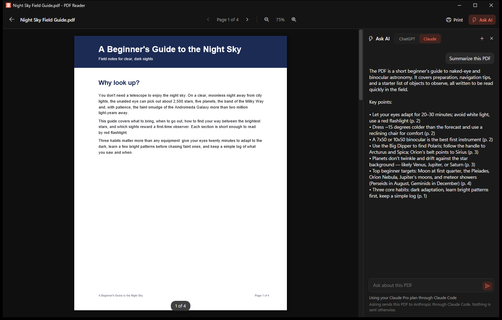
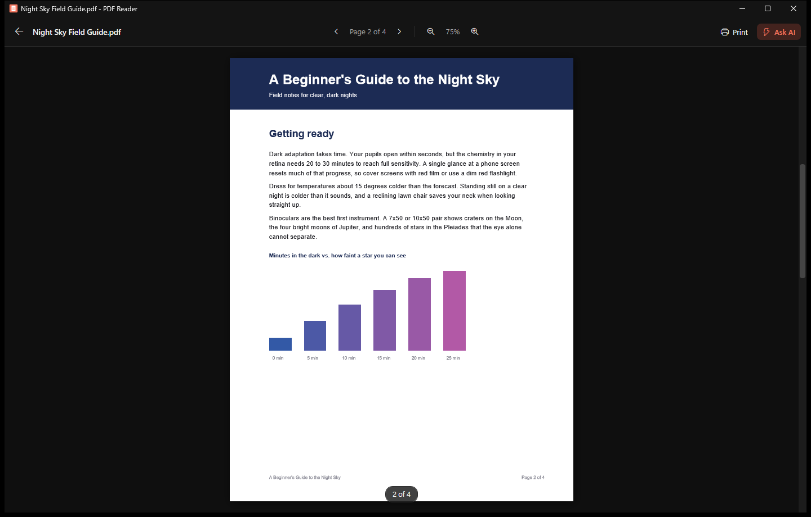
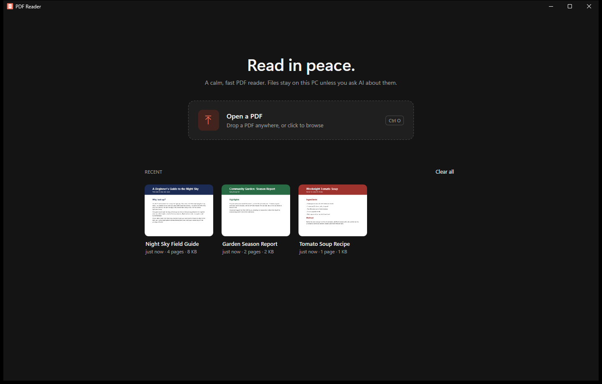
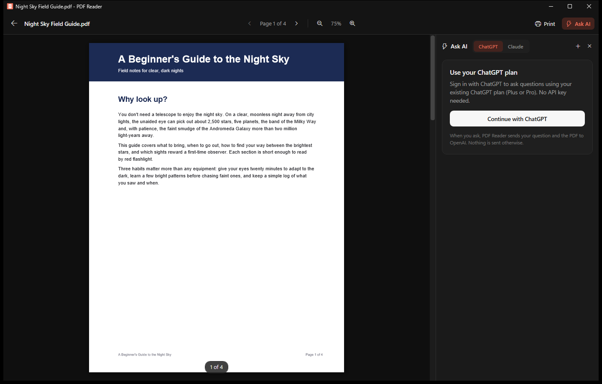

# PDF Reader

**A calm, fast, dark-mode PDF reader for Windows, with optional AI summaries and questions.**

PDF Reader does a few things well. It opens PDFs, shows them clearly, zooms, prints and gets out of your way. It's a small native Windows app, not a browser tab, with no account, no ads and no telemetry. If you want, you can ask ChatGPT or Claude to summarize the PDF you're reading or answer questions about it, using the plan you already pay for.



## Features

### Reading
- **A clean, dark interface** that keeps attention on the page.
- **Opens PDFs the way you expect:** double-click a file, drag one onto the window, or press **Ctrl+O**.
- **Page navigation:** the arrow keys, Page Up and Page Down, Home and End, or the page bar on the right. The mouse wheel turns the page when you scroll past the top or bottom.
- **Always know where you are:** a "2 of 4" page count sits on the page and in the toolbar.
- **Zoom:** fits the page to the window by default, with zoom from 10% to 800% using **Ctrl+wheel** or **Ctrl+Plus** and **Ctrl+Minus**.
- **Recent files** on the home screen, with page thumbnails.
- **Printing** through the standard Windows print dialog, with page ranges.



### Ask AI (optional)
- **Summarize** a PDF in one click, or **ask questions** about it in a chat beside the page. Answers cite page numbers.
- **Uses your existing plan, not an API key:**
  - **ChatGPT:** sign in with your ChatGPT account (Plus or Pro) on OpenAI's own page in your browser. PDF Reader never sees your password.
  - **Claude:** uses the [Claude Code](https://code.claude.com/docs/en/setup) app you've already installed and signed in to, with your Claude Pro or Max plan.
- **Private by default:** nothing leaves your PC until you ask a question. Then the PDF and your question go only to the service you picked.





## Install

1. Download `PDFReaderSetup-<version>.exe` from the [latest release](../../releases/latest).
2. Run it and choose **Install**. It installs for your Windows account only, so it doesn't need admin rights.
3. To make it your default PDF app, choose **Set as default** at the end of the install. You can also go to **Settings > Apps > Default apps**, search for `.pdf`, and pick **PDF Reader**.

To update, run a newer installer over the top. Your settings and sign-ins stay. To uninstall, go to **Settings > Apps > Installed apps**.

**Requirements:** Windows 11, 64-bit (Windows 10 should also work but hasn't been tested). The .NET Framework 4.8 runtime it uses is built into Windows.

> Windows SmartScreen may warn about the installer because it isn't code-signed. Choose **More info**, then **Run anyway**.

## Keyboard shortcuts

| Keys | Action |
| --- | --- |
| Left / Right, Page Up / Page Down | Previous / next page |
| Home / End | First / last page |
| Up / Down | Scroll the page |
| Ctrl+Plus / Ctrl+Minus, Ctrl+wheel | Zoom in / out |
| Ctrl+O | Open a PDF |
| Ctrl+P | Print |

## Privacy

- PDFs are read on your PC with the PDF engine built into Windows. Nothing is uploaded unless you use Ask AI.
- Settings, recent files and thumbnails are kept in `%LOCALAPPDATA%\PdfReader`. Sign-in tokens are encrypted to your Windows account.
- Ask AI is stateless: each question sends the PDF and the conversation so far to the service you chose. PDF Reader doesn't keep a copy anywhere else, and ChatGPT requests are sent with storage turned off.

## Build from source

You don't need Visual Studio or an SDK. The build uses the C# compiler that ships with Windows.

```powershell
powershell -ExecutionPolicy Bypass -File build.ps1
```

This produces `PdfReader.exe` and the installer at `dist\PDFReaderSetup-<version>.exe`. The version is set in `Setup.cs`.

| File | What it does |
| --- | --- |
| `PdfReader.cs` | The app: window, rendering, zoom, printing, settings and the Ask AI panel |
| `Main.xaml`, `Theme.xaml` | Layout and dark theme |
| `ChatGptAuth.cs` | Sign in with ChatGPT (browser sign-in with PKCE) |
| `ClaudeCode.cs` | Runs the local Claude Code app for Claude answers |
| `Setup.cs` | Per-user installer and uninstaller |

## Built with

C# and WPF on .NET Framework 4.8, plus the Windows.Data.Pdf rendering engine built into Windows. There are no third-party libraries.

## License

[MIT](LICENSE). Copyright (c) 2026 Nepal Plummer.
